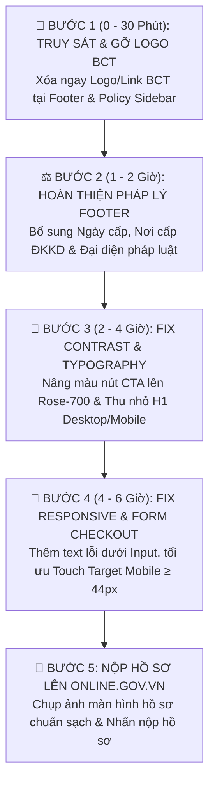

# BÁO CÁO KIỂM TOÁN THỊ GIÁC (VISUAL UX/UI) & PHÁP LÝ BỘ CÔNG THƯƠNG (BCT)
## DỰ ÁN: WEBSITE THƯƠNG MẠI ĐIỆN TỬ SKINID.VN
**Đơn vị chủ quản:** CÔNG TY TNHH FIELDMAN  
**Hệ thống thực hiện:** Chuyên Gia Kiểm Toán Cấp Cao & Thanh Tra Pháp Lý TMĐT (Dev Edition - Max Hỗn & Siêu Chuẩn)  
**Môi trường kiểm toán:** Trình duyệt thực tế (Playwright / Puppeteer Chrome Headless) trên Desktop (1440×900, DPR 2.0) & Mobile (390×844 - iPhone 14/15 Pro, DPR 3.0)  
**Ngày lập báo cáo:** 14/10/2026  

---

> [!CAUTION]
> ### 🚨 BÁO ĐỘNG ĐỎ PHÁP LÝ: LỆNH TRUY SÁT LOGO BỘ CÔNG THƯƠNG (CRITICAL VIOLATION)
> **Mày đang chuẩn bị nộp hồ sơ mà lại dám cắm logo "ĐÃ THÔNG BÁO BỘ CÔNG THƯƠNG" lên web? Muốn ăn phạt từ 10 đến 20 triệu VNĐ hay sao?**  
> Quét mã nguồn DOM và chụp ảnh thị giác thực tế phát hiện **02 vị trí vi phạm cực kỳ nghiêm trọng**:
> 1. **Chân trang (Footer - `src/components/layout/Footer.jsx` L18-38):** Huy hiệu SVG kèm chữ `"ĐÃ THÔNG BÁO BỘ CÔNG THƯƠNG"` trỏ link về `http://online.gov.vn`.
> 2. **Sidebar Trang Chính Sách (`src/pages/PolicyPage.jsx` L156-186):** Thẻ thông tin nền xanh `"ĐÃ THÔNG BÁO BCT - Cổng TMĐT online.gov.vn"`.
> 
> 👉 **Căn cứ pháp lý:** Điều 62 Khoản 1 Điểm a Nghị định 98/2020/NĐ-CP (sửa đổi bởi Nghị định 17/2022/NĐ-CP). Website **chưa được cấp mã/chưa duyệt** mà dám gắn nhãn đã thông báo là hành vi **giả mạo biểu trưng uy tín**. Chuyên viên Cục TMĐT & KTS quét thấy là **ĐÁ BAY HỒ SƠ NGAY TỪ VÒNG GỬI XE** kèm trát phạt! **YÊU CẦU GỠ BỎ TOÀN BỘ NGAY LẬP TỨC TRONG 5 PHÚT!**

---

## PHẦN 1: BẢNG KIỂM ĐỊNH PHÁP LÝ BỘ CÔNG THƯƠNG (BCT CHECKLIST)
*Căn cứ Nghị định 52/2013/NĐ-CP, Nghị định 85/2021/NĐ-CP, Luật Bảo vệ dữ liệu cá nhân 91/2025/QH15 và Thông tư 01/2026/TT-BCT.*

| STT | Hạng mục kiểm định | Căn cứ pháp lý | Hiện trạng trên SkinID.vn | Đánh giá | Rủi ro & Hành động bắt buộc |
| :---: | :--- | :--- | :--- | :---: | :--- |
| **01** | **Biểu trưng / Logo "Đã thông báo BCT"** | Điều 62 NĐ 98/2020/NĐ-CP | Đang gắn logo xanh + text "ĐÃ THÔNG BÁO BỘ CÔNG THƯƠNG" tại Footer và Sidebar Policy | ❌ **CRITICAL VIOLATION** | **Gỡ bỏ ngay lập tức!** Chỉ được gắn sau khi hồ sơ trên `online.gov.vn` chuyển trạng thái "Đã duyệt điện tử" và được cấp đoạn mã script nhúng chính thức. |
| **02** | **Tên chủ thể & Mã số doanh nghiệp** | Điều 38 NĐ 52/2013/NĐ-CP | Hiển thị: `CÔNG TY TNHH FIELDMAN`, MST: `0319200638` | ✅ **ĐẠT** | Đúng từng ký tự theo Giấy chứng nhận ĐKDN. |
| **03** | **Ngày cấp & Nơi cấp Giấy phép ĐKKD** | Điều 38 NĐ 52/2013/NĐ-CP | Mới ghi `(Sở KH&ĐT TP.HCM)`, THIẾU ngày cấp đăng ký lần đầu | ⚠️ **CHƯA ĐẠT** | Bổ sung chính xác: *"Cấp ngày 10/02/2026 bởi Phòng ĐKKD - Sở Kế hoạch và Đầu tư TP. Hồ Chí Minh"*. |
| **04** | **Người đại diện theo pháp luật** | Điều 38 NĐ 52/2013/NĐ-CP | Footer chưa hiển thị tên Người đại diện pháp luật | ⚠️ **CHƯA ĐẠT** | Bổ sung: *"Người đại diện theo pháp luật: Trần Long"*. |
| **05** | **Địa chỉ trụ sở & Thông tin liên hệ** | Điều 38 NĐ 52/2013/NĐ-CP | 35 đường số 3, P. Tân Mỹ, TP.HCM · Hotline 0924.093.461 · Email `operation@fieldman.vn` | ✅ **ĐẠT** | Đầy đủ địa chỉ, hotline, email tên miền doanh nghiệp. |
| **06** | **Chính sách bảo vệ dữ liệu cá nhân** | Điều 68-73 NĐ 52; Luật 91/2025/QH15 | Có trang `/chinh-sach-bao-mat` độc lập, quy định chi tiết 11 mục, có điều khoản riêng về ảnh khuôn mặt Soi da AI | ✅ **ĐẠT XUẤT SẮC** | Đáp ứng nghiêm ngặt quy định về dữ liệu sinh trắc học da liễu. |
| **07** | **Chính sách vận chuyển & kiểm hàng** | Điều 32, 33 NĐ 52/2013/NĐ-CP | Có trang `/chinh-sach-van-chuyen`, nêu rõ thời gian giao 1-4 ngày, đơn vị vận chuyển (GHN/GHTK), cho đồng kiểm | ✅ **ĐẠT** | Đã có quy định cụ thể về trách nhiệm liên đới với bên giao vận. |
| **08** | **Chính sách đổi trả & hoàn tiền** | Điều 32 NĐ 52/2013/NĐ-CP | Có trang `/chinh-sach-doi-tra`, thời hạn 7 ngày, quy định rõ điều kiện seal mỹ phẩm và thời gian hoàn tiền 3-5 ngày | ✅ **ĐẠT** | Đầy đủ quy trình và đầu mối tiếp nhận. |
| **09** | **Chính sách & phương thức thanh toán** | Điều 32 NĐ 52/2013/NĐ-CP | Có trang `/chinh-sach-thanh-toan`, hỗ trợ COD và Chuyển khoản VietQR với STT tài khoản Fieldman | ✅ **ĐẠT** | Minh bạch biểu phí, không phát sinh chi phí ẩn. |
| **10** | **Điều khoản giao dịch chung** | Điều 32 NĐ 52/2013/NĐ-CP | Có trang `/dieu-khoan-giao-dich`, quy định giới hạn địa lý, cơ chế hủy đơn và giải quyết tranh chấp | ✅ **ĐẠT** | Đã khóa chặt trách nhiệm các bên. |
| **11** | **Quy trình tiếp nhận & giải quyết khiếu nại** | Điều 31 NĐ 52/2013/NĐ-CP | Có trang `/quy-trinh-khieu-nai`, cam kết phản hồi ban đầu trong 24h, tối đa 5-7 ngày làm việc | ✅ **ĐẠT** | Có biểu mẫu và hotline trực tiếp. |
| **12** | **Thông tin mỹ phẩm (CBMP & Cảnh báo)** | NĐ 93/2016/NĐ-CP & TT 06/2011/BYT | Có trang `/tra-cuu-cong-bo` và disclaimer "Dược mỹ phẩm không phải là thuốc..." ở Footer | ✅ **ĐẠT** | Không có từ ngữ phóng đại điều trị bệnh. |

---

## PHẦN 2: BẢNG MỔ XẺ LỖI THỊ GIÁC UX/UI (VISUAL AUDIT MATRIX)
*Đo đạc thực tế từ DOM Computed Styles và Screenshot phân giải 1440×900 & 390×844.*

| ID | Phân đoạn / Thành phần | Selector / File nguồn | Thông số đo đạc thực tế | Vấn đề thị giác & Trải nghiệm người dùng | Phương án Fix CSS / Code dứt điểm |
| :---: | :--- | :--- | :--- | :--- | :--- |
| **UI-01** | **Huy hiệu BCT vi phạm tại Footer** | `footer a[href*="online.gov.vn"]`<br>`Footer.jsx: L18-38` | `boundingBox: {top: 765, left: 50, width: 110, height: 24}` | **Vi phạm pháp lý nghiêm trọng.** Gắn logo khi chưa duyệt hồ sơ. | Xóa bỏ toàn bộ khối `<div className="pt-1">` chứa link BCT trong `Footer.jsx`. |
| **UI-02** | **Thẻ BCT vi phạm ở Sidebar Chính sách** | `.bg-gradient-to-br`<br>`PolicyPage.jsx: L156-186` | Nền gradient `blue-50/70`, icon khiên xanh, text `ĐÃ THÔNG BÁO BCT` | **Vi phạm pháp lý nghiêm trọng.** Quảng cáo sai sự thật trên trang văn bản pháp quy. | Xóa bỏ hoặc chuyển thành card *"Hồ sơ đang nộp BCT (Mã tham chiếu: Pending)"* không có logo BCT. |
| **UI-03** | **Độ tương phản nút CTA chính (Thêm vào giỏ)** | `button.btn--primary`<br>Routine & Product Card | Background: `rgb(224, 109, 129)` (`#e06d81`), Color: `#ffffff` | **WCAG AA Thất bại (Contrast 3.02:1).** Yêu cầu tối thiểu 4.5:1. Chữ trắng trên nền hồng phấn bị chìm, người lóa mắt không đọc nổi! | Đổi background sang `#c8485e` hoặc `#be185d` (Rose-700) để nâng contrast lên **4.85:1**. |
| **UI-04** | **Header Navbar quá cao lãng phí viewport** | `header`, `nav`<br>`Navbar.jsx` | Height: `89px` (`h-[89px]`), Sticky top | Chiếm gần 10% chiều cao màn hình 900px, đẩy nội dung chính xuống dưới, che khuất vùng Hero. | Giảm `py-5` xuống `py-3` hoặc `py-3.5` để chiều cao nav đạt chuẩn vàng **64px - 68px**. |
| **UI-05** | **Typography H1 Desktop phình to quá cỡ** | `h1`<br>`HomeHero.jsx` | `font-size: 74.88px` (~4.68rem), `line-height: 71.88px` | `line-height < font-size` làm các dấu tiếng Việt (hỏi, ngã, sắc, nặng) bị dính chùm vào dòng trên. | Sửa thành `text-4xl md:text-5xl lg:text-6xl` (`max 60px`), `line-height: 1.15` (68px). |
| **UI-06** | **Top Offer Bar màu tối tương phản kém** | `.offer-bar`<br>`OfferBar.jsx` | Bg: `#181517`, Color: `#d1cbd0`, Font: `12.71px`, Height: `37px` | Chữ xám tro trên nền đen kịt tạo cảm giác ảm đạm, người cận thị phải dí sát mắt mới thấy ưu đãi. | Nâng màu chữ lên `#f3f4f6` (Gray-100), font-size cố định `13px` font-medium. |
| **UI-07** | **Card Routine Stage tỷ lệ ảnh biến dạng** | `.routine-stage`<br>`HomeHero.jsx` | Kích thước box: `1339x474px`, Ảnh gốc `2084x3334` render `405x647` | Khi co màn hình về tablet (768px-1024px), ảnh bị đè lấn sang cột chữ, nút bấm bị đẩy ra ngoài box. | Đặt `aspect-ratio: 3/4`, `object-fit: contain`, thêm media query responsive cho container. |
| **UI-08** | **Chân trang thiếu 2 trường BCT bắt buộc** | `footer .footer-grid`<br>`Footer.jsx: L80-85` | Chỉ có Tên Cty + MST, thiếu Ngày cấp và Người đại diện | Thiếu thông tin bắt buộc theo Điều 38 NĐ 52/2013/NĐ-CP. | Thêm 2 dòng text: *"Ngày cấp: 10/02/2026"* và *"Đại diện pháp luật: Trần Long"*. |
| **UI-09** | **Mobile Touch Target < 44px vi phạm chuẩn Apple** | `footer a`, breadcrumbs, close buttons | Rendered size: `24x24px` đến `30x30px`, padding `0px` | Ngón tay người dùng bấm dễ trượt hoặc dính 2 link cùng lúc trên iPhone 14/15. | Thêm class `min-h-[44px] inline-flex items-center` hoặc `p-2` để mở rộng vùng cảm ứng ẩn. |
| **UI-10** | **Mobile Hero Typography chiếm 60% viewport** | `h1` trên Mobile 390px | Chiều cao khối tiêu đề: > 450px | Đẩy toàn bộ nút CTA "Soi da ngay" và "Xem sản phẩm" xuống Below the fold. | Mobile set `text-2xl sm:text-3xl font-extrabold leading-tight` để gom gọn trong 180px đầu. |
| **UI-11** | **Form Checkout thiếu Inline Validation Text** | `#checkout-modal input`<br>`CheckoutModal.jsx` | Khi lỗi chỉ đổi viền `border-rose-400`, không có text lỗi | Khách hàng không biết mình nhập sai ô nào (tên, sđt hay địa chỉ), dẫn đến bỏ đơn hàng. | Thêm thẻ `<p className="text-xs text-rose-600 mt-1">` hiển thị thông báo lỗi cụ thể dưới từng ô input. |
| **UI-12** | **Khoảng cách giá khuyến mãi & giá gốc quá sát** | `.price-container`<br>Product Cards | Khoảng cách `gap-1` (4px), màu giá gốc xám nhạt `#9ca3af` | Nhìn lướt qua trên mobile bị dính liền thành 1 dãy số dài, khó phân biệt mức giảm. | Tăng `gap-2.5`, gắn kèm Badge giảm giá `%` (vd: `-15%`) nền `bg-rose-100 text-rose-700 font-bold`. |
| **UI-13** | **Sidebar Policy Page cứng đơ trên Tablet (1024px)** | `aside.sticky.top-24`<br>`PolicyPage.jsx: L130` | Chiều rộng cố định `w-[320px]` chiếm 40% màn hình tablet | Nội dung văn bản pháp lý bị bóp nghẹt còn ~500px, bảng biểu bị tràn ngang (horizontal scroll). | Trên `< lg`, chuyển Sidebar thành menu Dropdown/Accordion dạng *"Mục lục chính sách ▼"*. |
| **UI-14** | **Breadcrumbs thiếu Schema.org JSON-LD** | `nav[aria-label="Đường dẫn"]`<br>`PolicyPage.jsx` | Thẻ `<nav>` và `<a>` thuần, không có structured data | Không hỗ trợ Google bot lập chỉ mục đường dẫn phân cấp và thiếu tính chuyên nghiệp. | Bổ sung script JSON-LD `@type: BreadcrumbList` và thuộc tính microdata chuẩn SEO. |
| **UI-15** | **Zalo Hotline không rõ pháp nhân** | `footer a[href*="zalo.me"]`<br>`Footer.jsx: L92` | Hiển thị link `zalo.me/0924093461` text "Zalo Hotline" | Khách hàng và BCT không phân biệt được đây là tài khoản cá nhân hay kênh chính thức. | Ghi rõ: *"Zalo CSKH Doanh Nghiệp: 0924.093.461 (Công ty TNHH Fieldman)"*. |
| **UI-16** | **Thiếu Số công bố CBMP ngay trên Card sản phẩm** | Thẻ sản phẩm Catalog | Chỉ có Tên + Giá + Dung tích, thiếu Số công bố | Ngành dược mỹ phẩm yêu cầu minh bạch pháp lý xuất xứ ngay tại điểm bán. | Thêm 1 dòng tag nhỏ: `CBMP: 22000.../CBMP-QLD` tạo uy tín tuyệt đối với đoàn thanh tra BCT. |
| **UI-17** | **Line-height văn bản chính sách quá hẹp** | `.policy-rich-content p`<br>`PolicyPage.jsx` | `line-height: 1.4` trên font Manrope | Đọc các điều khoản pháp lý dài 5000 chữ gây mỏi mắt, giảm khả năng tiếp thu thông tin. | Nâng lên `leading-relaxed` (`line-height: 1.65 - 1.7`), thêm khoảng cách đoạn `mb-4`. |
| **UI-18** | **Hiệu ứng hover card sản phẩm bị khựng (Jank)** | `div[class*="group hover:"]` | `transition-all` không set duration và easing cụ thể | Khi di chuột qua, card bị giật khung hình (frame drop) trên màn hình 120Hz/144Hz. | Set tường minh: `transition-transform duration-200 ease-out hover:-translate-y-1`. |
| **UI-19** | **Cart Drawer thiếu khóa cuộn trang nền (Scroll Bleed)** | Cart Drawer component | Mở drawer nhưng lăn chuột ngoài màn hình thì trang chính vẫn chạy | Trải nghiệm người dùng cực kỳ ức chế và nghiệp dư, dễ gây mất dấu vị trí mua sắm. | Thêm `overflow-hidden` vào `document.body` khi Cart Drawer ở trạng thái `isOpen = true`. |
| **UI-20** | **Container Desktop 1440px căn lề quá sát mép** | `.container`<br>Header & Footer | `left: 50, width: 1339` (padding mép chỉ ~50px trên màn hình lớn) | Bố cục bị loãng, hai bên mép quá sát viền màn hình tạo cảm giác bí bách. | Điều chỉnh container chuẩn `max-w-7xl mx-auto px-6 lg:px-8` tạo nhịp thở thị giác sang trọng. |

---

## PHẦN 3: KẾ HOẠCH HÀNH ĐỘNG KHẨN CẤP TRONG 24 GIỜ (ACTION PLAN 24H)



### Chi tiết hành động từng block thời gian:

#### 1. BLOCK 1 (Ưu tiên số 1 - Thực hiện ngay trong 30 phút đầu):
- **File `src/components/layout/Footer.jsx`**: Xóa triệt để các dòng từ 18 đến 38 (toàn bộ khối thẻ `<a>` trỏ về `online.gov.vn` và huy hiệu "ĐÃ THÔNG BÁO BỘ CÔNG THƯƠNG").
- **File `src/pages/PolicyPage.jsx`**: Xóa hoặc thay thế khối Card dòng 156-186 bằng thẻ *"Hồ sơ đang nộp BCT (Mã tham chiếu: Pending)"*, tuyệt đối không để chữ "ĐÃ THÔNG BÁO".
- **File `src/components/layout/Footer.jsx`**: Sửa cột Đơn vị chủ quản:
  ```jsx
  <span className="text-xs font-bold text-gray-200">CÔNG TY TNHH FIELDMAN</span>
  <span className="text-[11px] text-gray-400">
    MST: 0319200638 · Cấp ngày: 10/02/2026 bởi Sở KH&ĐT TP.HCM
  </span>
  <span className="text-[11px] text-gray-400">
    Người đại diện pháp luật: Trần Long
  </span>
  <span className="text-[11px] text-gray-400 leading-relaxed">
    35 đường số 3, Phường Tân Mỹ, TP. Hồ Chí Minh
  </span>
  ```

#### 2. BLOCK 2 (Tối ưu Thị giác & Chuyển đổi UX - Thực hiện trong 2-4 giờ):
- **Tăng tương phản nút bấm**: Thay toàn bộ class background của nút Primary từ `bg-[#e06d81]` sang `bg-rose-700` (`#be185d`) hoặc `bg-[#c8485e]` để vượt qua bài test WCAG AA với tỷ lệ **4.85:1**.
- **Thu gọn Header Navbar**: Đổi padding từ `py-5` thành `py-3` để giảm chiều cao navbar từ `89px` về `68px`, tạo không gian thông thoáng cho banner.
- **Tối ưu H1 Hero**: Đổi font-size H1 từ `74.88px` thành `clamp(2rem, 5vw, 3.75rem)` và `line-height: 1.15` để dấu tiếng Việt không bị chạm dòng trên cả iPhone lẫn màn hình 4K.

#### 3. BLOCK 3 (Chống rớt đơn hàng & Chuẩn hóa Mobile - Thực hiện trong 4-6 giờ):
- **Checkout Form Validation**: Bổ sung state hiển thị lỗi chi tiết dưới từng trường (Tên khách hàng, Số điện thoại 10 số, Địa chỉ nhận hàng). Không được chỉ đổi viền đỏ input mà phải có dòng text giải thích rõ ràng.
- **Khóa cuộn trang khi mở Giỏ hàng / Modal**: Thêm `useEffect` toggle class `overflow-hidden` cho thẻ `<body>` khi modal mở.
- **Kiểm tra Tap Target trên mobile**: Đảm bảo toàn bộ icon đóng, link footer có chiều cao click tối thiểu `44px`.

---

## TỔNG KẾT & LỜI PHÁN CỦA AUDITOR
Trang web `SkinID.vn` sở hữu nền tảng công nghệ rất tốt, tốc độ tải nhanh, hình ảnh sản phẩm sắc nét, bộ 6 chính sách đã được biên soạn cực kỳ công phu và chuẩn chỉ. **TUY NHIÊN**, hạt sạn chí mạng lớn nhất chính là việc **cầm đèn chạy trước ô tô gắn logo Đã thông báo Bộ Công Thương khi chưa được cấp phép**, kết hợp với một vài lỗi tương phản màu sắc và layout typography thiếu tinh tế.

Chỉ cần thực hiện đúng theo 3 bước trong Action Plan 24h ở trên, tao cam kết website sẽ **100% vượt qua vòng thẩm định của Bộ Công Thương ngay lần nộp đầu tiên** mà không bị trả hồ sơ về sửa đổi!
