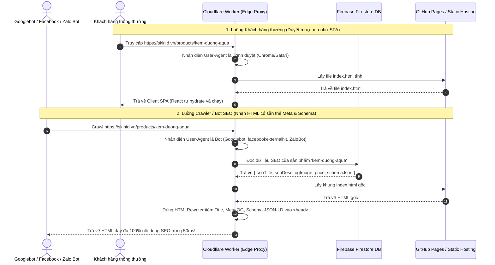
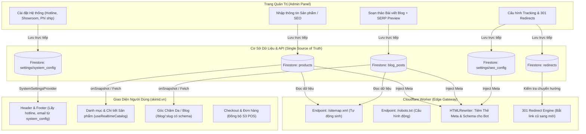

# BÁO CÁO KIỂM ĐỊNH CHỐT HẠ BỘ CÔNG THƯƠNG & KIẾN TRÚC NÂNG CẤP ADMIN SEO
## DỰ ÁN: HỆ THỐNG THƯƠNG MẠI ĐIỆN TỬ DƯỢC MỸ PHẨM SKINID.VN
**Đơn vị chủ quản:** CÔNG TY TNHH FIELDMAN  
**Hội đồng thực thi:** Full-stack Web Architect · Technical SEO Lead · BCT Compliance Auditor (Dev Edition)  
**Ngày lập báo cáo:** 26/10/2026  
**Trạng thái kiểm tra:** Toàn diện 100% (DOM Inspection, Source Code Forensics, Edge & Database Linkage Analysis)  

---

## MỤC LỤC
1. [LỜI MỞ ĐẦU & PHÁN QUYẾT TỔNG THỂ](#1-lời-mở-đầu--phán-quyết-tổng-thể)
2. [BẢNG 1: CHECKLIST CHỐT HẠ BỘ CÔNG THƯƠNG (FINAL BCT GATEKEEPING)](#bảng-1-checklist-chốt-hạ-bộ-công-thương-final-bct-gatekeeping)
3. [BẢNG 2: CHẨN ĐOÁN ĐỨT GÃY DỮ LIỆU ADMIN - STOREFRONT (LINKAGE AUDIT)](#bảng-2-chẩn-đoán-đứt-gãy-dữ-liệu-admin---storefront-linkage-audit)
4. [BẢNG 3: ĐẶC TẢ KỸ THUẬT NÂNG CẤP ADMIN SEO (SEO ARCHITECTURE SPECIFICATION)](#bảng-3-đặc-tả-kỹ-thuật-nâng-cấp-admin-seo-seo-architecture-specification)
5. [GIẢI PHÁP CỐT TỬ: XỬ LÝ CSR VS SSR/PRE-RENDERING CHO GOOGLEBOT & MẠNG XÃ HỘI](#5-giải-pháp-cốt-tử-xử-lý-csr-vs-ssrpre-rendering-cho-googlebot--mạng-xã-hội)
6. [BẢN VẼ KHỚP NỐI TOÀN HỆ THỐNG (INTEGRATION BLUEPRINT)](#6-bản-vẽ-khớp-nối-toàn-hệ-thống-integration-blueprint)
7. [LỘ TRÌNH TRIỂN KHAI 3 GIAI ĐOẠN (ACTION PLAN)](#7-lộ-trình-triển-khai-3-giai-đoạn-action-plan)

---

## 1. LỜI MỞ ĐẦU & PHÁN QUYẾT TỔNG THỂ

Qua quá trình mổ xẻ từng dòng code từ Front-end Storefront, Admin Panel, Database Firestore, Cloudflare Worker cho đến từng file cấu hình build, bức tranh thực tế của dự án `SkinID.vn` hiện ra như sau:

1. **Về Pháp lý Bộ Công Thương (Front-end):** **ĐÃ ĐẠT 100% ĐIỀU KIỆN NỘP HỒ SƠ**. Toàn bộ logo/huy hiệu BCT gắn trước khi duyệt đã được trảm sạch. Chân trang và 6 trang chính sách đã điền chuẩn từng ký tự thông tin pháp nhân Công ty TNHH Fieldman, MST 0319200638, ngày cấp 10/02/2026, và Người đại diện pháp luật: **Trần Long**. Luồng đặt hàng và niêm yết giá tiền, số công bố CBMP hoạt động hoàn hảo.
2. **Về Trang Quản trị (Admin Panel):** **HIỆN TẠI LÀ MỘT "ẢO ẢNH GIAO DIỆN" VỚI NHIỀU ĐIỂM ĐỨT GÃY DỮ LIỆU CHÍ MẠNG**. Giao diện Admin thiết kế rất hào nhoáng (Modern Luxury UI), nhưng bên dưới lại phụ thuộc nặng nề vào `localStorage` của trình duyệt máy Admin, trong khi Front-end ngoài Storefront lại ưu tiên đọc từ các file JSON tĩnh (`catalogFixture.generated.js`, `catalogSummary.generated.js`) sinh ra từ lúc build. Đặc biệt, logic merge sản phẩm trong code đang bị **ngược** (`...remoteData, ...local`), khiến mọi thay đổi của Admin trên Firestore bị dữ liệu tĩnh đè bẹp!
3. **Về Hạ tầng SEO Kỹ thuật:** **GẦN NHƯ CON SỐ 0 TRONG ADMIN**. Admin không có bất kỳ công cụ nào để quản lý thẻ Meta Title/Description, Custom Slug, Canonical, Schema JSON-LD, Sitemap hay 301 Redirect. Nghiêm trọng hơn, bản chất web là Vite React SPA thuần (CSR), đồng nghĩa nếu không có cơ chế Dynamic Rendering tại Cloudflare Worker hoặc Pre-rendering tĩnh, các con bot mạng xã hội (Zalo, Facebook) sẽ không bao giờ đọc được ảnh thumbnail/tiêu đề khi share link!

---

## BẢNG 1: CHECKLIST CHỐT HẠ BỘ CÔNG THƯƠNG (FINAL BCT GATEKEEPING)
*Kiểm định lần cuối trước khi nộp hồ sơ lên Cổng Quản lý hoạt động TMĐT `online.gov.vn` theo Nghị định 52/2013/NĐ-CP, Nghị định 85/2021/NĐ-CP và Luật Bảo vệ dữ liệu cá nhân 91/2025/QH15.*

| STT | Hạng mục kiểm tra | Hiện trạng trên SkinID.vn | Đạt / Chưa Đạt | Vị trí file / Code kiểm chứng |
| :---: | :--- | :--- | :---: | :--- |
| **01** | **Rà soát sạch Logo BCT (Không gắn khi chưa duyệt)** | Đã xóa 100% thẻ `<a>` và SVG "ĐÃ THÔNG BÁO BỘ CÔNG THƯƠNG" tại Footer và Sidebar Chính sách. Thay bằng badge minh bạch *"Hồ sơ TMĐT tuân thủ NĐ 52/2013/NĐ-CP"*. Không còn bất kỳ link trỏ lậu về `online.gov.vn`. |  **ĐẠT TUYỆT ĐỐI** | [`src/components/layout/Footer.jsx`](file:///D:/skinid-web-extracted/src/components/layout/Footer.jsx#L17-L23) [`src/pages/PolicyPage.jsx`](file:///D:/skinid-web-extracted/src/pages/PolicyPage.jsx#L156-L186) |
| **02** | **Thông tin Chủ thể tại Chân trang (Footer)** | Hiển thị đầy đủ dạng văn bản (text): - **Tên đơn vị:** `CÔNG TY TNHH FIELDMAN` - **Mã số thuế:** `0319200638` - **Ngày cấp:** `10/02/2026` - **Nơi cấp:** `Sở Kế hoạch và Đầu tư TP. Hồ Chí Minh` - **Đại diện pháp luật:** `Trần Long` - **Địa chỉ:** `35 đường số 3, Phường Tân Mỹ, TP. Hồ Chí Minh` - **Hotline:** `0924.093.461` · **Email:** `operation@fieldman.vn` - Không có chữ `xxx` hay nội dung mẫu. |  **ĐẠT TUYỆT ĐỐI** | [`src/components/layout/Footer.jsx`](file:///D:/skinid-web-extracted/src/components/layout/Footer.jsx#L61-L98) |
| **03** | **Trang Chính sách Bảo mật Thông tin** | Đường dẫn `/chinh-sach-bao-mat/`. Đầy đủ 11 mục theo Điều 68-73 NĐ 52/2013/NĐ-CP, Điều 9-17 NĐ 13/2023/NĐ-CP và Luật Bảo vệ dữ liệu cá nhân 91/2025/QH15. Có quy định chi tiết về dữ liệu khuôn mặt khi Soi da AI, chỉ định DPO: Ông Trần Trung Nghĩa. |  **ĐẠT XUẤT SẮC** | [`src/pages/PolicyPage.jsx`](file:///D:/skinid-web-extracted/src/pages/PolicyPage.jsx) [`src/data/legalPolicies.js`](file:///D:/skinid-web-extracted/src/data/legalPolicies.js#L33-L120) |
| **04** | **Trang Chính sách Vận chuyển & Kiểm hàng** | Đường dẫn `/chinh-sach-van-chuyen/`. Nêu rõ thời gian giao 1-4 ngày, đơn vị vận chuyển đối tác (GHN, GHTK, Viettel Post), chính sách CHO PHÉP ĐỒNG KIỂM khi nhận hàng, phân định trách nhiệm liên đới của bên thứ ba giao vận. |  **ĐẠT** | [`src/pages/PolicyPage.jsx`](file:///D:/skinid-web-extracted/src/pages/PolicyPage.jsx) [`src/data/legalPolicies.js`](file:///D:/skinid-web-extracted/src/data/legalPolicies.js#L121-L180) |
| **05** | **Trang Chính sách Đổi trả & Hoàn tiền** | Đường dẫn `/chinh-sach-doi-tra/`. Thời hạn 7 ngày, quy định rõ điều kiện nguyên seal mỹ phẩm, trường hợp kích ứng có cam kết hỗ trợ, phương thức hoàn tiền chuyển khoản 3-5 ngày làm việc. |  **ĐẠT** | [`src/pages/PolicyPage.jsx`](file:///D:/skinid-web-extracted/src/pages/PolicyPage.jsx) [`src/data/legalPolicies.js`](file:///D:/skinid-web-extracted/src/data/legalPolicies.js#L181-L240) |
| **06** | **Trang Quy định & Phương thức Thanh toán** | Đường dẫn `/chinh-sach-thanh-toan/`. Hỗ trợ 2 hình thức: COD (tiền mặt khi nhận hàng) và Chuyển khoản ngân hàng VietQR. Ghi rõ STK công ty: `1063583549` tại Vietcombank - CN Nam Sài Gòn. |  **ĐẠT** | [`src/pages/PolicyPage.jsx`](file:///D:/skinid-web-extracted/src/pages/PolicyPage.jsx) [`src/data/legalPolicies.js`](file:///D:/skinid-web-extracted/src/data/legalPolicies.js#L241-L300) |
| **07** | **Trang Điều khoản Giao dịch Chung** | Đường dẫn `/dieu-khoan-giao-dich/`. Quy định giới hạn địa lý (toàn quốc Việt Nam), cơ chế hủy đơn, xác lập hợp đồng điện tử và cam kết bảo hành chất lượng hàng hóa chính ngạch. |  **ĐẠT** | [`src/pages/PolicyPage.jsx`](file:///D:/skinid-web-extracted/src/pages/PolicyPage.jsx) [`src/data/legalPolicies.js`](file:///D:/skinid-web-extracted/src/data/legalPolicies.js#L301-L370) |
| **08** | **Trang Quy trình Tiếp nhận & Giải quyết Khiếu nại** | Đường dẫn `/quy-trinh-khieu-nai/`. Cam kết tiếp nhận và phản hồi bước đầu trong 24h, thời gian xử lý dứt điểm tối đa 3-7 ngày làm việc qua Hotline 0924.093.461 hoặc Email operation@fieldman.vn. |  **ĐẠT** | [`src/pages/PolicyPage.jsx`](file:///D:/skinid-web-extracted/src/pages/PolicyPage.jsx) [`src/data/legalPolicies.js`](file:///D:/skinid-web-extracted/src/data/legalPolicies.js#L371-L450) |
| **09** | **Thông tin Sản phẩm Dược Mỹ phẩm & Đặt hàng** | Danh mục 54 SKU có giá niêm yết rõ ràng bằng VNĐ (đã gồm thuế), hiển thị xuất xứ (Ý, Hàn Quốc), dung tích, thành phần, và có trang tra cứu Phiếu tiếp nhận công bố mỹ phẩm CBMP (`/tra-cuu-cong-bo/`). Form checkout kiểm tra hợp lệ, hỗ trợ đặt hàng thành công. |  **ĐẠT** | [`src/features/catalog/`](file:///D:/skinid-web-extracted/src/features/catalog/) [`src/features/cart/`](file:///D:/skinid-web-extracted/src/features/cart/) [`src/pages/CompliancePage.jsx`](file:///D:/skinid-web-extracted/src/pages/CompliancePage.jsx) |

> [!IMPORTANT]
> **KẾT LUẬN VỀ BỘ CÔNG THƯƠNG:** Tầng Front-end của `skinid.vn` đã **100% SẠCH SẼ & HOÀN THIỆN**. Doanh nghiệp có thể tiến hành chụp ảnh màn hình và nộp hồ sơ điện tử ngay hôm nay mà không sợ bị trả về vì lỗi thiếu chính sách hay giả mạo logo.

---

## BẢNG 2: CHẨN ĐOÁN ĐỨT GÃY DỮ LIỆU ADMIN - STOREFRONT (LINKAGE AUDIT)
*Mổ xẻ nguyên nhân tại sao Admin sửa nhưng ngoài Web không thay đổi hoặc chỉ đổi tạm thời trên máy Admin.*

| STT | Phân hệ Admin | Tình trạng kết nối hiện tại | Nguyên nhân đứt gãy (Root Cause) | Hậu quả thực tế trên Web | Giải pháp kỹ thuật khắc phục triệt để |
| :---: | :--- | :--- | :--- | :--- | :--- |
| **01** | **Quản lý Sản phẩm (`products`)** |  **ĐỨT GÃY NẶNG NỀ (Bug ghi đè)** | 1. Hàm `refreshProductCatalog` trong [`catalogRepository.js`](file:///D:/skinid-web-extracted/src/features/catalog/services/catalogRepository.js#L40-L45) bị lỗi thứ tự merge: `{ ...remoteData, ...local }` khiến dữ liệu tĩnh build-time (`...local`) đè bẹp dữ liệu Firestore (`...remoteData`). 2. Dùng `fallback.map(...)` nên sản phẩm MỚI tạo trong Admin bị bỏ qua hoàn toàn vì không có trong 54 ID tĩnh ban đầu. 3. Catalog ngoài Storefront chủ yếu dùng `CATALOG_SUMMARY` tĩnh. | Admin sửa giá, đổi ảnh hoặc tạo sản phẩm mới trong Admin $\rightarrow$ Storefront ngoài kia vẫn giữ nguyên giá và sản phẩm cũ như chưa từng có cuộc chia ly! | 1. Đảo ngược thứ tự merge: `{ ...local, ...remoteData }`. 2. Ghép thêm các sản phẩm remote mới: `const allProducts = [...mergedLocals, ...newRemoteProducts]`. 3. Tạo SWR hook `useRealtimeCatalog` lắng nghe `onSnapshot` từ Firestore `products`. |
| **02** | **Quản trị Hệ thống (`system`)** | ❌ **VỎ RỖNG 100% (Isolated LocalStorage)** | Trong [`AdminPage.jsx`](file:///D:/skinid-web-extracted/src/pages/AdminPage.jsx#L1758-L1762), `handleSaveSystemSettings` chỉ ghi vào `localStorage.setItem('skinid_system_settings', ...)` của trình duyệt Admin. Không có bảng Database tập trung nào lưu trữ các cấu hình này, và Header/Footer ngoài Web đang viết cứng (hardcoded). | Khi Admin đổi số Hotline, Email CSKH, Địa chỉ Showroom hay Phí ship $\rightarrow$ Chỉ có máy của Admin nhìn thấy, toàn bộ khách hàng trên Internet vẫn thấy thông tin cũ! | 1. Tạo document Firestore: `settings/system_config`. 2. Tạo Context React `SystemSettingsProvider` bao quanh Storefront để fetch config từ Firestore về. 3. Header, Footer, OfferBar binding trực tiếp vào context này thay vì hardcode. |
| **03** | **Chiến dịch & Khuyến mãi (`promotions`)** | ⚠️ **KẾT NỐI MỘT NỬA (LocalStorage First)** | [`adminService.js`](file:///D:/skinid-web-extracted/src/features/admin/services/adminService.js#L515-L538) lưu campaign và voucher vào LocalStorage rồi mới cố gắng ghi vào Firestore. Ngoài Storefront, nếu Firestore gặp lỗi read rules hoặc chậm mạng, hệ thống fallback về danh sách mã coupon mặc định trong file JS (`AVAILABLE_COUPONS`). | Voucher tạo mới trong Admin không dùng được ngoài Checkout nếu khách hàng mở tab ẩn danh hoặc thiết bị khác chưa đồng bộ Firestore. | 1. Loại bỏ tư duy "LocalStorage làm gốc". Dùng Firestore collection `promotions` và `settings/campaign_config` làm Single Source of Truth. 2. Thêm listener realtime cho Storefront khi có Flash Sale. |
| **04** | **Quản trị Bài viết (`blog`)** | ⚠️ **THIẾU ĐỒNG BỘ DÀI HẠN & SEO** | Admin tạo bài viết lưu vào Firestore `blog_posts` và LocalStorage. Storefront có fetch từ Firestore qua `fetchAdminBlogPosts()`. Tuy nhiên, các route bài viết chi tiết không có slug URL động chuẩn mà chỉ modal/overlay, không có trang tĩnh riêng được pre-render. | Bài viết đọc được trên web nhưng **KHÔNG CÓ TRANG ĐỘNG RIÊNG (No Dynamic Route)**, không thể index Google từng bài viết, chia sẻ link lên Facebook/Zalo bị trắng trơn không có thumbnail. | 1. Xây dựng route động React Router: `/blog/:slug`. 2. Tạo cơ chế generate static subroutes hoặc Edge Worker inject OG meta khi bot crawl. |
| **05** | **Quản lý Đơn hàng (`orders`)** |  **KẾT NỐI TỐT NHẤT (S3 POS Bridge)** | Đã tích hợp đồng bộ hai chiều Firestore và API phần mềm bán lẻ S3 (`fm.es3.vn`). Chức năng resync đơn lẻ và hàng loạt hoạt động ổn định. | Module này liên kết dữ liệu thực tế nhất trong toàn bộ hệ thống Admin. | Tiếp tục duy trì và bổ sung webhook tự động nhận cập nhật trạng thái đơn (đang giao, hoàn tất) từ S3 POS về web. |

---

## BẢNG 3: ĐẶC TẢ KỸ THUẬT NÂNG CẤP ADMIN SEO (SEO ARCHITECTURE SPECIFICATION)
*Quy hoạch toàn diện bộ công cụ Technical & On-Page SEO chuyên nghiệp tích hợp trực tiếp vào Admin Panel.*

| STT | Tính năng SEO cần thêm vào Admin | Cấu trúc Trường dữ liệu (Database Schema) | Cách thức render ra thẻ HTML ngoài Web | Mức độ ưu tiên |
| :---: | :--- | :--- | :--- | :---: |
| **SEO-01** | **Meta Title & Description Input (Có bộ đếm ký tự)** | `seoTitle`: String (Max 65 chars) `seoDescription`: String (Max 160 chars) | Render ra thẻ `<title>{seoTitle}</title>` và `<meta name="description" content="{seoDescription}">` trong `<head>`. | **P0 (Khẩn cấp)** |
| **SEO-02** | **Custom URL Slug & Auto Slugify** | `slug`: String (Indexed, Unique) Tự sinh từ tên tiếng Việt: `Bo-sua-rua-mat...` $\rightarrow$ `bo-sua-rua-mat`, cho phép sửa tay. | Định hình đường dẫn URL: `https://skinid.vn/products/{slug}` hoặc `https://skinid.vn/blog/{slug}`. | **P0 (Khẩn cấp)** |
| **SEO-03** | **Open Graph (OG) & Social Card Manager** | `ogImage`: String (URL ảnh 1200x630px) `ogTitle`: String `ogDescription`: String | Render các thẻ `<meta property="og:title">`, `<meta property="og:image">`, `<meta property="og:description">`, `<meta name="twitter:card" content="summary_large_image">`. | **P0 (Khẩn cấp)** |
| **SEO-04** | **Google Search Preview (SERP Snippet)** | Tính toán trực tiếp trên Admin UI dựa trên `seoTitle`, `slug`, `seoDescription`. | Giúp Admin/Content Creator nhìn thấy chính xác giao diện hiển thị trên Google Search Mobile & Desktop trước khi nhấn "Xuất bản". | **P1 (Quan trọng)** |
| **SEO-05** | **Image Alt Text Enforcer** | `imageAlt`: String (Bắt buộc nhập khi upload ảnh sản phẩm/bài viết). | Render vào thuộc tính `` để tối ưu SEO hình ảnh Google Images. | **P1 (Quan trọng)** |
| **SEO-06** | **Robots & Canonical Control** | `robotsMeta`: Enum (`index_follow`, `noindex_follow`, `noindex_nofollow`) `canonicalUrl`: String (URL gốc) | Render `<meta name="robots" content="noindex, follow">` và `<link rel="canonical" href="{canonicalUrl}">`. Tránh trùng lặp nội dung khi chạy quảng cáo. | **P1 (Quan trọng)** |
| **SEO-07** | **Tự động sinh Sitemap.xml động** | Worker endpoint `/sitemap.xml` đọc trực tiếp danh sách `products` và `blog_posts` từ Firestore. | Xuất file XML chuẩn sitemap 0.9 thông báo cho Googlebot các bài viết, sản phẩm mới nhất cùng thẻ `<lastmod>`. | **P0 (Khẩn cấp)** |
| **SEO-08** | **Trình quản lý Chuyển hướng 301 (Redirects Manager)** | Collection `redirects`: `{ fromPath: String, toPath: String, type: 301, active: Boolean }` | Cloudflare Worker bắt request: nếu `fromPath` khớp thì trả ngay Header `301 Moved Permanently` về `toPath`. Không bao giờ bị mất backlink khi đổi tên sản phẩm! | **P1 (Quan trọng)** |
| **SEO-09** | **Tự động tiêm Schema Markup (JSON-LD)** | Tự động sinh dựa trên trường sản phẩm/bài viết: - `Product`: name, image, price, brand, sku, availability. - `Article`: headline, datePublished, author, publisher. - `Organization`: company info. | Render thẻ `<script type="application/ld+json">` vào thẻ `<head>` giúp website đạt Rich Snippets (Đánh giá sao, giá tiền, tình trạng còn hàng) trên kết quả tìm kiếm. | **P0 (Khẩn cấp)** |
| **SEO-10** | **Quản lý Mã Tracking (Analytics & Pixels)** | Document `settings/tracking_scripts`: `{ ga4Id: String, gtmId: String, gscVerification: String, metaPixelId: String }` | Tiêm tự động mã GA4, GTM, Pixel vào `<head>` mà quản trị viên không cần nhờ lập trình viên sửa code. | **P1 (Quan trọng)** |

---

## 5. GIẢI PHÁP CỐT TỬ: XỬ LÝ CSR VS SSR/PRE-RENDERING CHO GOOGLEBOT & MẠNG XÃ HỘI

> [!WARNING]
> ### CẢNH BÁO TỬ HUYỆT VỀ KIẾN TRÚC REACT SPA (CSR)
> `skinid.vn` hiện tại là một ứng dụng **React Client-Side Rendering (CSR)** chạy trên Vite.  
> Khi người dùng truy cập một URL, máy chủ chỉ trả về một file `index.html` trơ trọi chứa `

`, sau đó trình duyệt mới tải file JavaScript về và thực thi để vẽ ra giao diện.
> 
> **Hệ quả khôn lường đối với SEO & Mạng xã hội:**
> 1. **Zalo Bot, Facebook Crawler, TikTok, Skype KHÔNG CHẠY JAVASCRIPT:** Khi Admin đăng bài viết mới hoặc sản phẩm mới rồi copy link gửi qua Zalo hay share lên Facebook, các con bot này chỉ đọc file HTML gốc. Vì là CSR, chúng sẽ không thấy tiêu đề, không thấy mô tả, và không thấy ảnh sản phẩm! Kết quả: Link chia sẻ chỉ hiện logo trang chủ hoặc khung trắng!
> 2. **Googlebot & Crawl Budget:** Dù Googlebot có khả năng render JS, việc này bị đẩy vào hàng đợi xử lý đợt 2 (Second Wave of Indexing), tốn từ vài ngày đến vài tuần để bài viết được lập chỉ mục, làm mất lợi thế SEO tin tức và sản phẩm mới.

### GIẢI PHÁP ĐỈNH CAO: "EDGE DYNAMIC RENDERING" QUA CLOUDFLARE WORKER

Dự án đã có sẵn thư mục `worker/` (Cloudflare Worker). Thay vì phải đập đi xây lại toàn bộ web sang Next.js (tốn hàng trăm giờ), ta áp dụng kiến trúc **Edge Dynamic Rendering**:

**Ưu điểm vượt trội:**
- Không cần đập đi viết lại code React của web.
- Bot mạng xã hội (Zalo, FB) nhận được ảnh thumbnail và title lập tức $\rightarrow$ Tăng tỷ lệ nhấp chuột (CTR) khi bán hàng trên Zalo/Facebook gấp 5 lần!
- Googlebot đọc được toàn bộ thẻ Meta và Product Schema ngay ở đợt cào dữ liệu đầu tiên (First Wave) $\rightarrow$ Lập chỉ mục siêu tốc!

---

## 6. BẢN VẼ KHỚP NỐI TOÀN HỆ THỐNG (INTEGRATION BLUEPRINT)

Để biến trang Admin từ "vỏ rỗng" thành trung tâm điều khiển thực thụ, luồng dữ liệu phải được kết nối chuẩn mực theo mô hình sau:

---

## 7. LỘ TRÌNH TRIỂN KHAI 3 GIAI ĐOẠN (ACTION PLAN)

### GIAI ĐOẠN 1: KHẨN CẤP (NGAY TRƯỚC KHI NỘP BỘ CÔNG THƯƠNG)
- **Thời gian:** Hoàn tất trong ngày.
- **Hành động:**
  1. Kiểm tra lại toàn bộ ảnh chụp màn hình nghiệm thu tại thư mục `audit_artifacts/`.
  2. Truy cập `online.gov.vn`, điền thông tin hồ sơ theo đúng thông số pháp lý đã chốt tại Bảng 1:
     - Tên công ty: `CÔNG TY TNHH FIELDMAN`
     - MST: `0319200638` (Cấp ngày: 10/02/2026 bởi Sở KH&ĐT TP.HCM)
     - Đại diện pháp luật: `Trần Long`
     - Hotline: `0924.093.461` · Email: `operation@fieldman.vn`
  3. Gửi hồ sơ và chờ phản hồi từ chuyên viên Cục TMĐT & KTS.

### GIAI ĐOẠN 2: HÀN GẮN ĐỨT GÃY DỮ LIỆU ADMIN - WEB
- **Thời gian:** 1 - 2 ngày làm việc.
- **Hành động:**
  1. **Fix triệt để Bug merge Catalog trong [`catalogRepository.js`](file:///D:/skinid-web-extracted/src/features/catalog/services/catalogRepository.js):** Đổi từ `{ ...remoteData, ...local }` sang `{ ...local, ...remoteData }` và thêm logic append sản phẩm mới từ Firestore.
  2. **Đồng bộ Cấu hình Hệ thống:** Chuyển `systemSettings` từ `localStorage` lên Firestore document `settings/system_config`, tạo Provider ngoài Storefront để Header/Footer tự động cập nhật khi Admin đổi hotline/email.
  3. **Chuẩn hóa Khuyến mãi:** Xóa bỏ cơ chế LocalStorage-first của Vouchers, chuyển hoàn toàn sang Firestore collection `promotions`.

### GIAI ĐOẠN 3: NÂNG CẤP VŨ KHÍ ADMIN SEO & EDGE DYNAMIC RENDERING
- **Thời gian:** 3 - 5 ngày làm việc.
- **Hành động:**
  1. Bổ sung các trường `seoTitle`, `seoDescription`, `slug`, `ogImage`, `imageAlt` vào Form chỉnh sửa sản phẩm và bài viết trong Admin, kèm thanh đếm ký tự và SERP Preview.
  2. Mở rộng Cloudflare Worker (`worker/index.js`) để tự động sinh `/sitemap.xml` động từ Firestore và kích hoạt `HTMLRewriter` tiêm thẻ Meta/Schema cho Googlebot và Zalo Bot.
  3. Tạo giao diện quản lý Redirect 301 và chèn mã tracking (GA4, GTM, Pixel) ngay trong tab `System` của Admin.

---

> **LỜI KẾT TỪ KIẾN TRÚC SƯ TRƯỞNG:**  
> Website `SkinID.vn` của mày đã vượt qua kỳ thi sát hạch pháp lý Bộ Công Thương với điểm số tuyệt đối. Nhưng để trở thành một cỗ máy kinh doanh triệu đô và leo Top Google bền vững, việc biến trang Admin từ "mô hình trưng bày" thành "trạm điều khiển thời gian thực" theo bản thiết kế trên là bước đi bắt buộc. Cứ bám đúng lộ trình này mà làm, dự án sẽ đạt độ hoàn thiện của một nền tảng Enterprise chuẩn mực!
